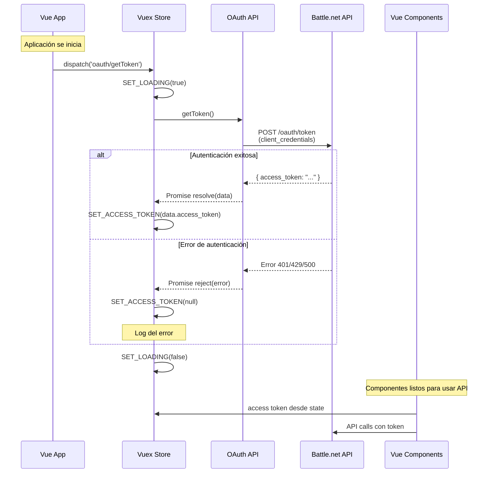

# Diagrama de Flujo de Autenticación

Este diagrama muestra cómo funciona la autenticación OAuth 2.0 en la aplicación:

## Pasos del Flujo

1. **Inicio de la aplicación**: La Vue app se inicializa y llama al método `init()`
2. **Solicitud de token**: Se dispara la acción `oauth/getToken` en Vuex
3. **Estado de carga**: Se activa el indicador de loading
4. **Petición OAuth**: Se hace POST a Battle.net con las credenciales de cliente
5. **Respuesta exitosa**: Se guarda el token en el estado de Vuex
6. **Error**: Se limpia el token y se registra el error
7. **Finalización**: Se desactiva el indicador de loading
8. **Uso del token**: Los componentes pueden hacer llamadas autenticadas a la API